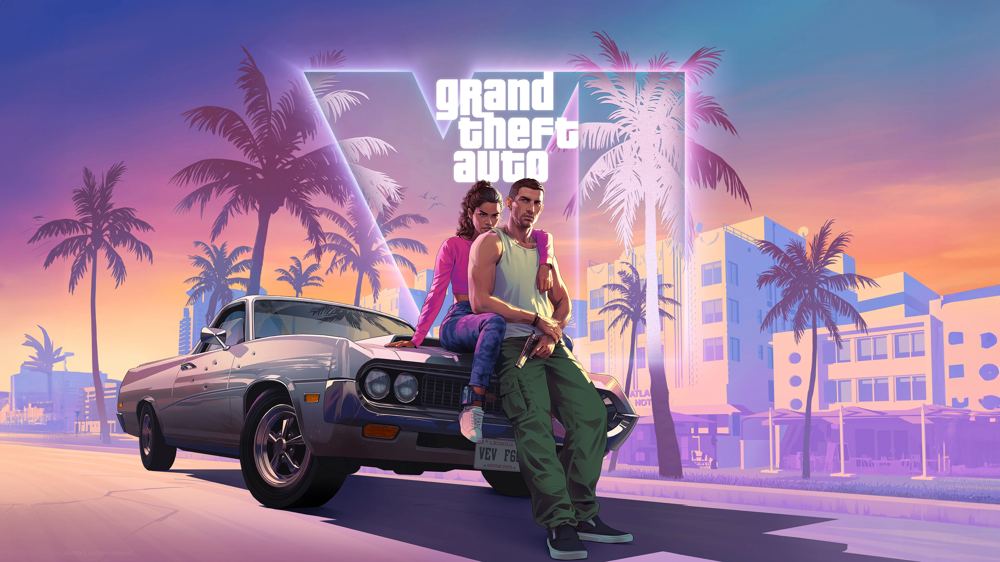

# 🎮 BackLog · Your Gaming Story

<p align="center">
  
</p>

<p align="center">
  <strong>Great games. Better memories. Your gaming story belongs here.</strong><br>
  Uma aplicação web moderna, cinematográfica e 100% client-side para organizar, acompanhar e descobrir seus jogos favoritos.
</p>

<p align="center">
  
  
  
  
  
  
  
</p>

<p align="center">
  
</p>

---

## 📖 1. Visão Geral & Pitch

O **BackLog** nasce da necessidade que todo gamer tem: uma central rápida, elegante e descomplicada para organizar sua coleção de jogos sem burocracia. Em vez de depender de plataformas pesadas, logins obrigatórios ou algoritmos invasivos, o **BackLog** oferece uma experiência cinematográfica focada no que realmente importa: **jogar, lembrar e planejar suas próximas aventuras**.

Com uma arquitetura **100% voltada ao navegador (client-side)** e **zero dependências externas**, todos os seus dados ficam salvos de forma privada no `localStorage` do seu próprio dispositivo. Seja rodando direto de uma pasta local (`file:///`) ou hospedado na nuvem, o aplicativo inicia instantaneamente, oferece busca com atalhos de teclado e adapta sua identidade visual a cada jogo do catálogo.

---

## ✨ 2. Principais Funcionalidades

- 🗃️ **Gestão Granular de Coleção (6 Status):** Classifique seus jogos com um clique entre *Jogado*, *Jogando*, *Zerado*, *Platinado*, *Dropado* e *Quero jogar*.
- ⚡ **Pesquisa Instantânea & Normalização:** Busca em tempo real por título, franquia ou apelidos (aliases), imune a acentuação gráfica (`normalize('NFD')`).
- ⌨️ **Atalho Rápido de Teclado:** Pressione `/` a qualquer momento para focar a barra de pesquisa, no padrão das melhores ferramentas modernas.
- 🎯 **Filtros Combinados & Ordenação:** Navegue por gênero (*Ação*, *Aventura*, *Terror*, *RPG*, *Sandbox*, *MOBA*, *Shooter*), alterne entre catálogo geral e coleção pessoal, e ordene de A–Z, Z–A ou por destaques.
- 🔗 **Persistência de Estado na URL:** Compartilhe ou salve buscas e filtros diretamente pelo link (`?q=...&saved=1&genre=...&status=...&sort=...`) através da API de `history.replaceState`.
- 🖼️ **Páginas Dinâmicas de Detalhes (`game.html`):** Uma única página inteligente que renderiza dinamicamente qualquer jogo via parâmetros de URL (`?id=...`), exibindo backdrops cinematográficos em 4K, metadados (estúdio, ano, plataformas) e enquadramentos calculados para desktop e mobile.
- 💡 **Motor de Recomendações Contextuais:** Sugestões inteligentes ao final de cada página priorizando títulos da mesma franquia e sucessos da comunidade.
- 📣 **Compartilhamento Nativo com Clipboard API:** Modal elegante para copiar o link exato do jogo para a área de transferência com feedback sonoro e visual por toasts.
- ⭐ **Comunidade & Resenhas:** Feed na página inicial com críticas completas da comunidade em elementos colapsáveis acessíveis (`<details>` / `<summary>`).
- 📱 **Design Responsivo & Dark Gaming Aesthetic:** Interface imersiva construída sobre uma paleta sóbria (`#131414`) com detalhes dourados (`#ffd21f`), tipografia refinada e menu drawer otimizado para dispositivos móveis.

---

## 🏷️ 3. Sistema Canônico de Status

A coleção é gerenciada por meio de seis estados canônicos, cada um com representação visual única e persistência no armazenamento local do navegador:

| Status | ID Interno | Ícone | Significado / Critério |
| :--- | :---: | :---: | :--- |
| **Jogado** | `played` | 🕹️ | Títulos que você já experimentou, mas não necessariamente concluiu a história. |
| **Jogando** | `playing` | ▶️ | Jogos ativos na sua rotina atual. |
| **Zerado** | `completed` | ✔️ | Campanha principal ou história terminada com sucesso. |
| **Platinado** | `platinum` | 🏆 | Conquista máxima: 100% dos troféus, missões e segredos completados. |
| **Dropado** | `dropped` | ⏸️ | Jogos abandonados ou pausados por tempo indeterminado. |
| **Quero jogar** | `want-to-play` | 📌 | Sua lista de desejos / próximo da fila para começar. |

> [!NOTE]
> **Compatibilidade Retroativa:** Registros salvos na versão legada sob a flag `'saved'` são automaticamente promovidos para `'want-to-play'` sem perda de dados para o usuário.

---

## 📚 4. Distribuição do Catálogo

O projeto já conta com **40 títulos emblemáticos** curados e catalogados com capas em alta resolução (padrão 3:4 / 600×800 com desfoque de fundo) e banners horizontais:

```
┌────────────────────────────────────────────────────────┐
│               DISTRIBUIÇÃO POR FRANQUIA                │
├────────────────────────────┬───────────────────────────┤
│ Resident Evil              │ 11 Jogos (1996 a Requiem) │
│ Grand Theft Auto           │ 8 Jogos (GTA 1 ao GTA VI) │
│ God of War                 │ 6 Jogos (Clássicos e Nórd)│
│ Marvel's Spider-Man        │ 3 Jogos (Peter & Miles)   │
│ The Last of Us             │ 2 Jogos (Part I & Part II)│
│ Overwatch                  │ 2 Jogos (1 & 2)           │
│ League of Legends          │ 1 Jogo                    │
│ Standalones & Futuros      │ 7 Jogos (Minecraft, RDR2, │
│                            │ Silent Hill, Phantom Blade│
├────────────────────────────┴───────────────────────────┤
│ TOTAL: 40 Jogos Canônicos Curados                      │
└────────────────────────────────────────────────────────┘
```

---

## 📂 5. Arquitetura e Árvore de Diretórios

A estrutura do projeto foi planejada de forma modular, separando a base estática compartilhada das views especializadas:

```bash
BackLog/
├── index.html                   # Landing page: hero, destaques, favoritos e reviews
├── README.md                    # Documentação técnica e guia do repositório
│
├── css/                         # Folhas de estilo da landing page
│   ├── site.css                 # Design tokens globais, reset, header, navegação e footer
│   └── style.css                # Estilização exclusiva da página inicial (grid, reviews)
│
├── js/                          # Núcleo de lógica e dados
│   ├── games.js                 # Catálogo canônico dos 40 jogos (BacklogGames)
│   ├── site.js                  # Gerenciador global de coleção, localStorage e atalhos
│   └── catalog.js               # Motor de busca, filtros de gênero/status e paginação
│
├── view/                        # Páginas secundárias e suas dependências
│   ├── pagina_jogos.html        # Catálogo interativo completo com filtros e abas
│   ├── game.html                # Página dinâmica de detalhes do jogo selecionado
│   ├── css_game/style.css       # Estilos específicos da página de detalhes
│   ├── css_paginaJogos/style.css# Estilos da barra de ferramentas e grid do catálogo
│   └── js/game.js               # Renderização dinâmica via URL (?id=), modal e status
│
├── imagens/                     # Ativos gráficos e identidades
│   ├── banners/                 # Banners horizontais em alta definição (WebP)
│   ├── capas/catalogo/          # Capas padronizadas 600x800 com proporção 3:4
│   ├── destaques/               # Imagens responsivas para o radar com múltiplos srcsets
│   ├── logo_transparente.png    # Logo oficial do BackLog
│   └── gta-vi-banner-4k.webp    # Imagem de destaque 4K do GTA VI
│
└── docs/                        # Registros técnicos e decisões de design
    └── catalogo/                # Notas de revisão de capas, banners e franquias
```

---

## 🚀 6. Guia de Instalação e Execução

O **BackLog** não requer compiladores, transpiladores ou gerenciadores de pacotes (`npm`, `yarn`, `cargo`). Você pode executá-lo imediatamente em qualquer sistema operacional:

### Opção 1: Execução Direta (Sem Servidor)
Dê um duplo clique no arquivo `index.html` ou abra-o diretamente no navegador de sua preferência (`Chrome`, `Firefox`, `Edge`, `Safari`).

### Opção 2: Servidor Local via Python (Recomendado)
Para uma experiência idêntica à de produção (com histórico de rotas e sem avisos de protocolo `file://`):

```bash
# Navegue até a pasta raiz do projeto
cd c:\Users\gabri\OneDrive\Documentos\projetos_solo\pendentes\BackLog

# Inicie o servidor embutido do Python
python -m http.server 8000
```
Em seguida, abra seu navegador em: **`http://localhost:8000`**

### Opção 3: Extensão VS Code Live Server
Se estiver utilizando o Visual Studio Code:
1. Instale a extensão **Live Server** (`ritwickdey.liveserver`).
2. Clique com o botão direito em `index.html`.
3. Selecione **"Open with Live Server"**.

---

## ⌨️ 7. Atalhos de Teclado & Usabilidade

| Tecla / Combinação | Onde Funciona | Ação Executada |
| :---: | :--- | :--- |
| <kbd>/</kbd> | Qualquer página | Foca instantaneamente na caixa de busca global. |
| <kbd>Esc</kbd> | Mobile / Modal | Fecha o menu gaveta mobile ou descarta a janela modal de compartilhamento. |
| <kbd>Enter</kbd> | Barra de busca | Submete o termo e redireciona automaticamente para o catálogo com resultados filtrados. |
| <kbd>Tab</kbd> | Navegação geral | Acesso aos links de salto acessíveis (*Skip to content*) e controle via teclado. |

---

## 🛠️ 8. Contrato de Dados (Como Adicionar Novos Jogos)

Todos os jogos são declarados no arquivo `js/games.js` dentro do array global `window.BacklogGames`. Para registrar um novo título, basta adicionar um objeto seguindo o schema abaixo:

```javascript
{
    "id": "nome-do-jogo",                   // Obrigatório: Slug único em minúsculas com hífens
    "title": "Nome do Jogo",               // Obrigatório: Nome oficial completo
    "cover": "catalogo/nome-do-jogo.webp", // Obrigatório: Imagem 600x800 dentro de imagens/capas/
    "genre": "Action",                     // Obrigatório: 'Action' | 'Adventure' | 'Horror' | 'MOBA' | 'RPG' | 'Sandbox' | 'Shooter'
    "tags": ["Action", "Adventure"],       // Obrigatório: Lista de tags exibidas no card
    "studio": "Nome do Estúdio",           // Obrigatório: Desenvolvedora ou publicadora
    "caption": "Frase de efeito marcante", // Obrigatório: Subtítulo ou slogan do jogo
    "description": "Sinopse do jogo...",   // Obrigatório: Texto descritivo para a página de detalhes
    "banner": "banners/nome-banner.webp",  // Obrigatório: Imagem panorâmica dentro de imagens/
    "bannerPosition": "center center",     // Obrigatório: Alinhamento CSS no desktop
    "bannerPositionMobile": "50% center",  // Obrigatório: Alinhamento CSS no smartphone
    
    // Campos Opcionais
    "franchise": "Nome da Franquia",       // Opcional: Agrupa jogos e alimenta recomendações
    "year": 2024,                          // Opcional: Ano de lançamento
    "platforms": ["PC", "PS5", "Xbox"],    // Opcional: Lista de plataformas suportadas
    "aliases": ["Sigla", "Nome Alternativo"], // Opcional: Termos extras para busca
    "releaseState": "upcoming"             // Opcional: 'upcoming' (futuro) | 'retired' (histórico)
}
```

### Regras Canônicas para Artes e Mídias
- **Capas (`imagens/capas/catalogo/`):** Dimensão recomendada de **600 × 800 px** (formato WebP). A arte original é sempre preservada sem cortes agressivos; quando a proporção original difere de 3:4, utiliza-se uma extensão desfocada da própria arte.
- **Banners (`imagens/banners/`):** Formato panorâmico (WebP) com peso otimizado, permitindo ajuste fino de foco visual via propriedades `bannerPosition` e `bannerPositionMobile`.

---

## 🎨 9. Design System & Variáveis CSS

O projeto utiliza um conjunto estrito de tokens de design declarados no escopo raiz (`:root`) em `css/site.css`:

```css
:root {
    color-scheme: dark;
    --bg: #131414;        /* Fundo principal escuro profundo */
    --surface: #1a1b1b;   /* Superfície de cards e seções */
    --line: #2c2d2c;      /* Linhas e bordas sutis */
    --text: #f5f5ef;      /* Texto de alto contraste e legibilidade */
    --muted: #a1a39b;     /* Texto secundário e legendas */
    --yellow: #ffd21f;    /* Cor de destaque (ouro/âmbar) */
    --radius: 12px;       /* Arredondamento padrão de bordas */
}
```

---

## 👨‍💻 10. Autor e Créditos

Desenvolvido com dedicação por **Gabriel** como um projeto solo para celebração e preservação da cultura gamer.

- **Concepção & Desenvolvimento:** Gabriel
- **Ativos & Marcas:** Todas as marcas registradas, títulos, capas e logotipos mencionados pertencem a seus respectivos proprietários legais (Rockstar Games, Sony Interactive Entertainment, Capcom, Epic Games, Naughty Dog, Mojang Studios, Riot Games, Blizzard Entertainment, etc.).

---

<p align="center">
  <sub>BackLog · Feito para quem ama grandes jogos e melhores memórias.</sub>
</p>
