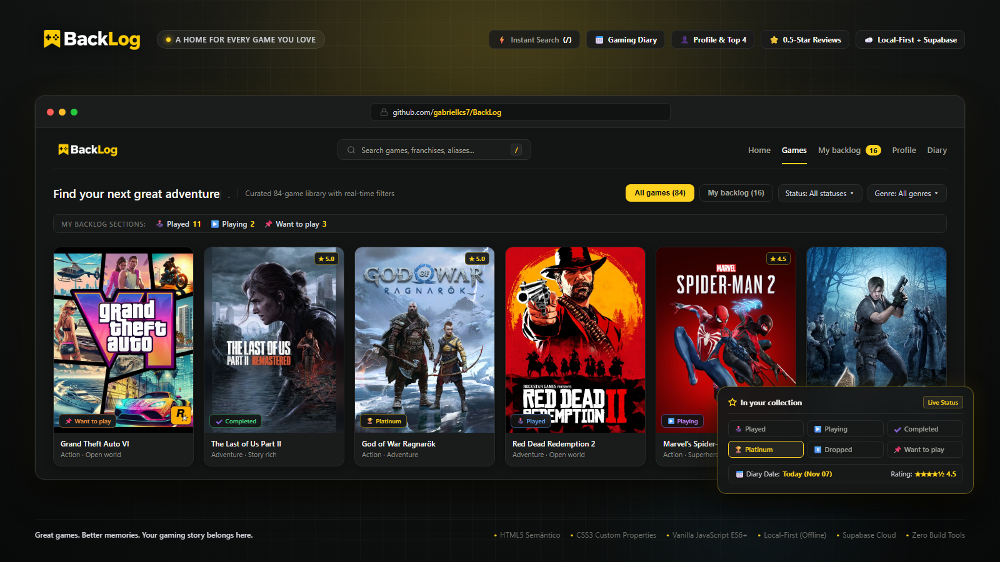

# 🎮 BackLog

BackLog é uma aplicação web para catalogar jogos, registrar datas de jogatina em um diário cronológico e organizar listas pessoais. Funciona direto no navegador sem login (com armazenamento no `localStorage`), com suporte a sincronização na nuvem e recursos de comunidade através do Supabase.

[](https://github.com/gabriellcs7/BackLog)


<p align="center">
  
</p>

---

## Como funciona

O projeto opera em dois modos:

1. **Modo local (offline por padrão):** Você abre a aplicação e usa imediatamente. Seu perfil, Top 4 de favoritos, listas personalizadas, avaliações e o diário de jogatina ficam salvos no `localStorage` do seu navegador. Nenhum dado sai do seu computador e não é necessário criar conta.
2. **Modo conectado (com Supabase):** Ao vincular um projeto Supabase, você pode criar uma conta com e-mail e senha. Seus dados passam a sincronizar na nuvem, seu perfil ganha uma página pública com seguidores, suas listas podem ser compartilhadas e você pode curtir e comentar nas avaliações de outros jogadores.

---

## Funcionalidades

### Catálogo e Coleção
- **84 jogos canônicos:** Títulos de 23 franquias consagradas (Uncharted, Silent Hill, Resident Evil, Counter-Strike, Grand Theft Auto, God of War, The Witcher, Watch Dogs, Spider-Man, Outlast, entre outras), cadastrados em `js/games.js` com capas 3:4 (600×800) e artes horizontais.
- **Seis status de progresso:** Cada jogo pode ser marcado como *Played*, *Playing*, *Completed*, *Platinum*, *Dropped* ou *Want to play*.
- **Backlog organizado por seções:** Na página de jogos (`view/pagina_jogos.html`), a aba da sua coleção divide os títulos em três áreas com contadores próprios: **Played** (que reúne títulos jogados, zerados, platinados e dropados), **Playing** e **Want to play**.
- **Busca unificada (jogos e jogadores):** Atalho global com a tecla <kbd>/</kbd> para focar a pesquisa de qualquer página. O mecanismo ignora acentos (`normalize('NFD')`), localiza jogos por título, franquia ou siglas conhecidas e pesquisa perfis de outros jogadores da comunidade.
- **Filtros por 10 gêneros:** Filtre por Action, Adventure, Fighting, Horror, MOBA, RPG, Sandbox, Shooter, Sports ou Survival, com ordenação por destaques, A–Z ou Z–A.
- **URLs sincronizadas:** Parâmetros de pesquisa, gênero, status e ordenação são refletidos na URL (`?q=...&saved=1&genre=...`) via `history.replaceState`.

### Diário de Jogos (`view/diary.html`)
- **Linha do tempo cronológica:** Toda vez que você avalia ou altera a resenha de um jogo, o sistema registra uma entrada com a data escolhida (hoje por padrão ou datas passadas). Datas futuras são bloqueadas.
- **Métricas no topo:** Contadores de total de entradas (**Entries**), jogos distintos registrados (**Games**) e dias de jogatina anotados (**Days Logged**).
- **Filtros dedicados:** Busca por título, seleção de mês específico e separação entre entradas com resenha escrita ou apenas nota numérica.
- **Edição segura:** Você pode alterar a data de um registro ou removê-lo do diário sem apagar a avaliação principal do jogo nem perder seu status na coleção.
- **Auto-status:** Ao registrar uma entrada no diário para um jogo que ainda não possui status, ele é automaticamente classificado como *Played*. Status prévios (como *Playing* ou *Want to play*) nunca são sobrescritos.

### Perfil, Conexões e Listas (`view/profile.html`)
- **Identidade do jogador:** Nome de exibição, biografia curta e upload de foto de perfil personalizada (JPG, PNG ou WebP de até 5 MB, com corte quadrado automático).
- **The Favorite Four (Top 4):** Escolha quatro jogos favoritos para ficarem fixados em destaque conjunto no topo do seu perfil, sem ordem ou hierarquia. O diálogo inclui busca em tempo real com visualização gráfica das capas.
- **Rede social e seguidores:** Sistema de seguir (*Follow/Unfollow*) outros jogadores, com contadores de seguidores e seguindo e modal de conexões.
- **Atividade recente e estatísticas:** Linha do tempo com as últimas avaliações e atualizações de coleção do perfil, além de métricas anuais de jogatina.
- **Diário público:** Visitantes podem consultar o histórico cronológico de jogos de qualquer perfil público por ano.
- **Listas personalizadas com ranking opcional:** Crie coleções temáticas públicas ou privadas. A opção **Rank this list** permite ordenar itens numericamente para criar Top 5, Top 10 ou rankings de preferência com reordenação de posições.
- **Importação do dispositivo:** Um botão no perfil transfere favoritos e listas salvos no navegador para a nuvem. Listas importadas iniciam privadas por padrão.

### Avaliações e Comunidade
- **Notas de meia estrela (0.0 a 5.0):** Seletor interativo que aceita frações de 0.5. Clique no lado esquerdo da estrela para meia nota, no lado direito para nota inteira, ou use as setas do teclado.
- **Resenhas de até 3.000 caracteres:** Contador de caracteres dinâmico com suporte a edição e cancelamento sem perda acidental do rascunho.
- **Feed comunitário por jogo:** Veja análises publicadas por outros jogadores na página de cada jogo.
- **Curtidas com regra de unicidade:** Cada pessoa pode curtir uma review uma única vez. As regras de banco impedem que o autor curta a própria publicação.
- **Comentários de até 1.000 caracteres:** Discussões paginadas com opção de exclusão pelo próprio autor do comentário.
- **Feeds sociais na página inicial (`index.html`):**
  - *Popular Reviews:* As três avaliações mais curtidas da comunidade.
  - *Fresh from your circle:* Feed com as resenhas recentes publicadas pelos jogadores que você segue.

---

## Catálogo de Franquias (84 Jogos)

| Franquia | Jogos no Catálogo | Exemplos de Títulos |
| :--- | :---: | :--- |
| **Resident Evil** | 11 | RE 1996, RE2 1998, Nemesis, Code: Veronica, Zero, RE4, RE5, RE6, Biohazard, Village, Requiem |
| **Silent Hill** | 9 | Silent Hill 1999, SH2, SH3, The Room, Origins, Homecoming, Shattered Memories, Downpour, Townfall, f |
| **Grand Theft Auto** | 8 | GTA, GTA 2, GTA III, Vice City, San Andreas, GTA IV, GTA V, GTA VI |
| **God of War** | 6 | GoW 2005, GoW II, GoW III, Ascension, GoW 2018, Ragnarök |
| **Counter-Strike** | 5 | Counter-Strike 1.6, Condition Zero, Source, Global Offensive, Counter-Strike 2 |
| **Uncharted** | 5 | Drake's Fortune, Among Thieves, Drake's Deception, A Thief's End, The Lost Legacy |
| **Marvel's Spider-Man** | 3 | Marvel's Spider-Man, Miles Morales, Spider-Man 2 |
| **Watch Dogs** | 3 | Watch Dogs, Watch Dogs 2, Watch Dogs: Legion |
| **Outlast** | 3 | Outlast, Outlast 2, The Outlast Trials |
| **The Witcher** | 3 | The Witcher, The Witcher 2: Assassins of Kings, The Witcher 3: Wild Hunt |
| **The Last of Us** | 2 | The Last of Us, The Last of Us Part II |
| **Overwatch** | 2 | Overwatch (2016), Overwatch 2 |
| **Hollow Knight** | 2 | Hollow Knight, Hollow Knight: Silksong |
| **Alan Wake** | 2 | Alan Wake, Alan Wake 2 |
| **EA Sports FC** | 2 | EA Sports FC 24, EA Sports FC 27 |
| **SUPERHOT** | 2 | SUPERHOT, SUPERHOT: MIND CONTROL DELETE |
| **Cyberpunk** | 2 | Cyberpunk 2077, Cyberpunk: Orion |
| **The Forest** | 2 | The Forest, Sons of the Forest |
| **Injustice** | 2 | Injustice: Gods Among Us, Injustice 2 |
| **League of Legends** | 1 | League of Legends |
| **Roblox** | 1 | Roblox |
| **Phasmophobia** | 1 | Phasmophobia |
| **Independentes & Outros** | 7 | Minecraft, Fortnite, Red Dead Redemption, Red Dead Redemption 2, Phantom Blade Zero, Minecraft Dungeons II |

---

## Estrutura de arquivos

```text
BackLog/
├── index.html                   # Página inicial: hero, destaques, popular reviews e feed de seguidos
├── README.md                    # Documentação oficial do projeto
├── servidor.py                  # Servidor HTTP local dedicado com cabeçalhos anti-cache
│
├── css/
│   ├── site.css                 # Tokens de design (cores, tipografia, espaçamento), reset e navegação
│   ├── style.css                # Estilos específicos da página inicial
│   ├── social.css               # Estilos para perfis, seguidores, listas, modais e feed social
│   └── diary.css                # Estilos do diário de jogos e linha do tempo
│
├── js/
│   ├── games.js                 # Catálogo canônico dos 84 jogos
│   ├── config.js                # Chaves públicas de conexão com o Supabase
│   ├── account.js               # Estado da sessão, login, cadastro e importação
│   ├── site.js                  # Controle global de status, atalhos de teclado e contadores
│   ├── catalog.js               # Lógica de filtros, pesquisa de jogos/jogadores e catálogo
│   ├── reviews.js               # Validação de notas fracionadas e salvamento de reviews
│   ├── diary.js                 # Manipulação das entradas temporais do diário
│   ├── community.js             # Requisições de feed social, conexões, likes e comentários
│   ├── ui.js                    # Toasts, notificações acessíveis e diálogos
│   └── vendor/
│       ├── supabase.js          # Biblioteca oficial @supabase/supabase-js v2.119.0
│       └── SUPABASE-LICENSE.txt # Licença MIT do cliente Supabase
│
├── view/
│   ├── pagina_jogos.html        # Catálogo geral, busca de jogadores e visualização da coleção
│   ├── game.html                # Página do jogo: metadados, avaliação pessoal e feed comunitário
│   ├── profile.html             # Perfil do jogador, seguidores, Top 4, listas ranqueadas e conta
│   ├── diary.html               # Linha do tempo cronológica do diário com filtros
│   ├── css_game/style.css       # Estilos da página de detalhes do jogo
│   ├── css_paginaJogos/style.css# Estilos do grid e da barra de filtros do catálogo
│   └── js/                      # Scripts controladores de cada página
│       ├── game.js              # Carregamento dinâmico do jogo via parâmetro ?id=
│       ├── review.js            # Formulário de avaliação e estrelas fracionadas
│       ├── community.js         # Renderização do feed social e envio de comentários
│       ├── profile.js           # Gerenciamento de perfil, foto, Top 4 e criador de listas
│       └── diary.js             # Filtros e paginação do diário de jogos
│
├── supabase/
│   ├── setup.sql                # Criação completa do banco para novas instalações
│   ├── atualizar-uncharted.sql  # Registro dos 5 títulos Uncharted no banco existente
│   ├── atualizar-catalogo-novembro.sql # Registro dos novos jogos no banco existente
│   ├── atualizar-diario.sql     # Script de migração para o diário cronológico
│   └── migrations/              # Histórico das migrações SQL com políticas RLS
│
├── imagens/
│   ├── backlog-showcase-banner.png # Imagem de capa do README (1600x900)
│   ├── banner_builder.html      # Template HTML usado para renderizar o banner oficial
│   ├── banners/                 # Banners horizontais em alta definição (WebP)
│   ├── capas/catalogo/          # Capas padronizadas 600x800 com proporção 3:4
│   ├── destaques/               # Imagens responsivas do radar com múltiplos tamanhos
│   └── logo_transparente.png    # Logotipo oficial
│
└── docs/
    ├── supabase.md              # Passo a passo de configuração do projeto no Supabase
    ├── reviews.md               # Detalhes de implementação do sistema de avaliações
    ├── diary.md                 # Regras de negócio e comportamento do diário
    └── catalogo/                # Documentação das 23 franquias, capas e fontes
```

---

## Como executar localmente

### Pré-requisitos
- Um navegador moderno (Chrome, Firefox, Edge ou Safari).
- Python 3 instalado.

### Passo a passo

```bash
# 1. Clone o repositório
git clone https://github.com/gabriellcs7/BackLog.git

# 2. Entre na pasta do projeto
cd BackLog

# 3. Inicie o servidor local anti-cache
python servidor.py
```

Abra o endereço `http://localhost:8000` no seu navegador.

> O script `servidor.py` desativa o cache de arquivos `.html`, `.css` e `.js` durante o desenvolvimento, garantindo que qualquer alteração no código apareça imediatamente ao recarregar a página.

---

## Configuração do Supabase (Opcional)

Para ativar cadastro de contas, perfis públicos, seguidores, sincronização de listas e comentários comunitários:

### 1. Criar o banco de dados
Acesse [supabase.com](https://supabase.com), crie um projeto gratuito e abra o **SQL Editor**:
- Para um projeto novo: execute o conteúdo consolidado de `supabase/setup.sql`.
- Para projetos já existentes: execute os arquivos de atualização pertinentes em `supabase/` (como `atualizar-catalogo-novembro.sql` e `atualizar-uncharted.sql`).

Todas as tabelas contam com políticas de **Row Level Security (RLS)** ativas. Visitantes anônimos só leem dados públicos, e operações de escrita exigem autenticação do próprio autor.

### 2. Configurar URLs de autenticação
No painel do Supabase, acesse **Authentication** > **URL Configuration**:
- **Site URL:** defina como `http://localhost:8000` (ou o domínio final quando publicar o site).
- **Redirect URLs:** adicione `http://localhost:8000/view/profile.html` (e a URL equivalente do seu domínio público).

### 3. Conectar o frontend
No Supabase, vá em **Project Settings** > **API**, copie a **Project URL** e a **Publishable Key** (chave `anon` pública) e informe no arquivo `js/config.js`:

```javascript
window.BacklogConfig = Object.freeze({
    supabaseUrl: 'https://SEU-PROJETO.supabase.co',
    supabasePublishableKey: 'sb_publishable_SUA_CHAVE_PUBLICA'
});
```

### Tabela de variáveis

| Configuração | Arquivo | Obrigatório | Descrição |
|---|---|:---:|---|
| `supabaseUrl` | `js/config.js` | Não | URL do seu projeto no Supabase (`https://<id>.supabase.co`). |
| `supabasePublishableKey` | `js/config.js` | Não | Chave pública do tipo `anon` ou `sb_publishable_...`. Nunca utilize chaves secretas ou de `service_role`. |

---

## Atalhos de teclado

| Tecla | Contexto | Ação |
|:---:|---|---|
| <kbd>/</kbd> | Em qualquer tela | Foca diretamente no campo de pesquisa da barra de navegação. |
| <kbd>Esc</kbd> | Diálogos e mobile | Fecha modais abertos (diário, listas, seguidores, login, compartilhamento) ou recolhe o menu no celular. |
| <kbd>Enter</kbd> | Campo de busca | Submete a consulta e abre a página de jogos com os resultados filtrados. |
| <kbd>←</kbd> / <kbd>→</kbd> | Avaliação do jogo | Altera a nota pessoal em passos de 0.5 estrelas. |
| <kbd>Tab</kbd> | Navegação geral | Percorre os elementos focáveis respeitando o link de salto inicial (*Skip to content*). |

---

## Como cadastrar novos jogos

Para incluir jogos no catálogo local, adicione um novo objeto ao array `window.BacklogGames` no arquivo `js/games.js`:

```javascript
{
    "id": "slug-do-jogo",                   // Obrigatório: identificador único em minúsculas com hífen
    "title": "Nome do Jogo",               // Obrigatório: título oficial completo
    "cover": "catalogo/slug-do-jogo.webp", // Obrigatório: caminho relativo dentro de imagens/capas/
    "genre": "Action",                     // Obrigatório: Action, Adventure, Fighting, Horror, MOBA, RPG, Sandbox, Shooter, Sports ou Survival
    "tags": ["Action", "Adventure"],       // Obrigatório: categorias exibidas nos cartões
    "studio": "Estúdio Desenvolvedor",     // Obrigatório: estúdio ou publicadora
    "caption": "Subtítulo de destaque",    // Obrigatório: frase de efeito usada nas visualizações
    "description": "Texto descritivo...",  // Obrigatório: sinopse exibida na página de detalhes
    "banner": "banners/slug-banner.webp",  // Obrigatório: arte horizontal dentro de imagens/
    "bannerPosition": "center center",     // Obrigatório: alinhamento CSS do banner no desktop
    "bannerPositionMobile": "50% center",  // Obrigatório: alinhamento CSS do banner no mobile
    
    // Campos opcionais
    "franchise": "Nome da Franquia",       // Agrupa títulos relacionados e alimenta recomendações
    "year": 2024,                          // Ano de lançamento original
    "platforms": ["PC", "PS5", "Xbox"],    // Lista de plataformas suportadas
    "aliases": ["Sigla", "Outro Nome"],    // Termos extras aceitos pela pesquisa
    "releaseState": "upcoming"             // Use 'upcoming' para lançamentos ou 'retired' para jogos históricos
}
```

Para que contas online possam interagir com títulos novos no feed e nas listas, o mesmo `id` precisa ser inserido na tabela `games` do banco de dados Supabase.

---

## Design System

As variáveis globais de estilo estão centralizadas no arquivo `css/site.css`:

```css
:root {
    color-scheme: dark;
    --bg: #131414;        /* Fundo escuro principal */
    --surface: #1a1b1b;   /* Fundo de cards, painéis e modais */
    --line: #2c2d2c;      /* Linhas divisórias e contornos */
    --text: #f5f5ef;      /* Texto de alto contraste */
    --muted: #a1a39b;     /* Texto secundário e legendas */
    --yellow: #ffd21f;    /* Cor de destaque âmbar/dourada */
    --radius: 12px;       /* Raio padrão de arredondamento */
}
```

---

## Autor

Projeto desenvolvido por **Gabriel** ([@gabriellcs7](https://github.com/gabriellcs7)).

Repositório: [https://github.com/gabriellcs7/BackLog](https://github.com/gabriellcs7/BackLog)

*As imagens de capas, capturas de tela e marcas registradas citadas pertencem aos seus respectivos proprietários legais (Sony Interactive Entertainment, Rockstar Games, Capcom, Konami, Valve, CD Projekt RED, Ubisoft, Red Barrels, Epic Games, Naughty Dog, Mojang Studios, Riot Games, Blizzard Entertainment, entre outros).*
