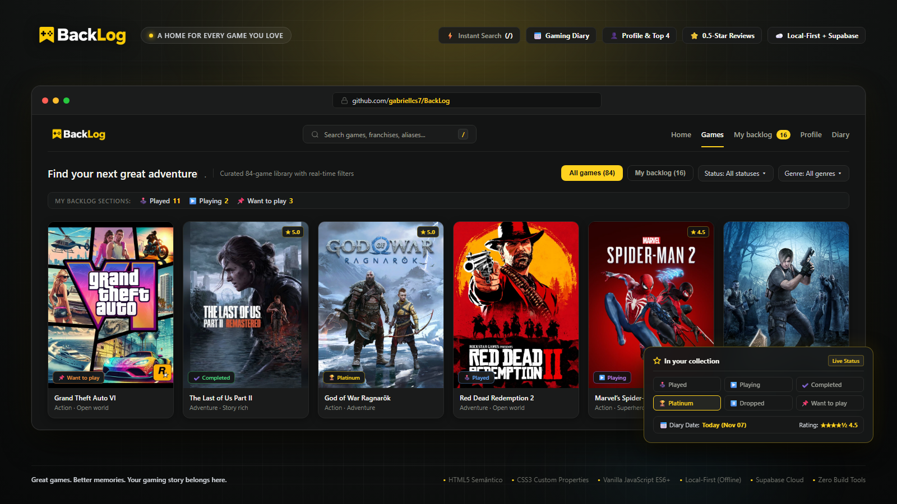

# 🎮 BackLog

BackLog é uma aplicação web feita para catalogar jogos, registrar sessões de jogatina em um diário cronológico, organizar listas personalizadas e compartilhar avaliações com a comunidade. Funciona direto no navegador sem login (com armazenamento no `localStorage`), com suporte a sincronização na nuvem e recursos sociais via Supabase.

[](https://github.com/gabriellcs7/BackLog)


<p align="center">
  
</p>

---

## Como funciona

O projeto opera em dois modos:

1. **Modo local (offline por padrão):** Abra a aplicação no navegador e use imediatamente. Perfil, Top 4 de favoritos, listas ranqueadas ou livres, avaliações e diário cronológico ficam salvos no `localStorage`. Nenhum dado sai da sua máquina e nenhuma conta é exigida.
2. **Modo conectado (com Supabase):** Ao preencher as chaves do Supabase no arquivo `js/config.js`, a aplicação ativa autenticação por e-mail, sincronização em tempo real na nuvem, upload de fotos e banners de perfil, distribuição comunitária de notas, feed social de seguidos, central de atividades e busca de jogadores.

---

## Novidades e Destaques Recentes

- **Catálogo Expandido (100 Jogos):** 100 títulos com capas em alta definição, banners panorâmicos, logos transparentes e metadados completos de franquia, estúdio, plataformas e ambientação.
- **Túnel 3D em Perspectiva (`js/game-tunnel.js`):** Navegação imersiva em perspectiva tridimensional pelos jogos em destaque, acionada pela rolagem suave da página, com inclinação interativa pelo cursor e atalhos de teclado.
- **Vitrine Cinematográfica (`js/cinematic-backlog.js`):** Seção interativa com mockup de smartphone, iluminação dinâmica ao rolar a tela e linha do tempo de coleção.
- **Galeria de Personagens do Catálogo (`js/game-characters.js`):** Mais de 440 biografias curadas em 90 jogos, com 371 retratos dedicados (`imagens/personagens/`) e sinopses sem spoilers.
- **Notícias Editoriais de Games (`css/gaming-news.css`):** Painel estático com as principais novidades oficiais da indústria (PlayStation.Blog, Xbox Wire, etc.) sem bibliotecas externas.
- **Controle de Movimento (`js/presentation-motion.js`):** Alternador de acessibilidade para animações (`auto`, `full`, `reduced`), respeitando as configurações do sistema sem desativar efeitos para quem deseja visualizá-los.
- **Distribuição Gráfica de Avaliações (`view/js/game-ratings.js`):** Histograma de notas comunitárias de 0.5 a 5.0 estrelas na página de cada jogo e no perfil, acompanhado de estatísticas compactas.
- **Listas Ranqueadas (`docs/ranked-lists.md`):** Crie listas numeradas (Top 5, Top 10, até 100 jogos) com reordenação de posições por teclado, setas ou arrastar e soltar.
- **Perfil Aprimorado com Banner Personalizado:** Defina um banner exclusivo no perfil vinculado a qualquer jogo do catálogo, selecione sua plataforma principal (PC, PlayStation, Xbox, Nintendo, etc.), informe localização e website.
- **Reordenação dos Favoritos (Top 4):** Capas destacadas com suporte a arrastar e soltar ou reordenação rápida via teclado.
- **Busca Unificada de Jogos e Jogadores:** Barra de busca global com atalho `/` que localiza tanto títulos e franquias quanto perfis de usuários com foto redonda.

---

## Funcionalidades

### 1. Catálogo e Coleções (`view/pagina_jogos.html`)
- **Filtros Combinados:** Status da coleção, ordenação (Destaques, A-Z, Z-A) e 10 gêneros (`Action`, `Adventure`, `Fighting`, `Horror`, `MOBA`, `RPG`, `Sandbox`, `Shooter`, `Sports`, `Survival`).
- **6 Status de Coleção:** `Played` (Jogado), `Playing` (Jogando), `Completed` (Zerado), `Platinum` (Platinado), `Dropped` (Dropado) e `Want to play` (Quero jogar).
- **Cartões com Efeito Parallax:** Profundidade de camada ao rolar a página e acesso rápido à marcação de status sem sair do catálogo.

### 2. Página do Jogo (`view/game.html`)
- **Banner Panorâmico & Logo Oficial:** Cabeçalho cinematográfico contextual com posição customizada para mobile e desktop.
- **Distribuição de Notas Comunitárias:** Gráfico de frequência por estrelas (degraus de 0.5 em 0.5) e cálculo da nota média.
- **Elenco e Personagens:** Carrossel de personagens com retratos e descrições dos papéis na história.
- **Avaliações com Meio Ponto:** Editor de resenhas com notas de 0.5 a 5.0 estrelas (notas zero foram eliminadas para manter apenas resenhas qualificadas).
- **Diário Integrado:** Opção de registrar a data exata da jogatina diretamente ao postar uma avaliação.

### 3. Diário de Jogos (`view/diary.html`)
- **Linha do Tempo Cronológica:** Registro das sessões por data, ordenadas do mais recente para o mais antigo.
- **Filtro por Ano:** Navegação rápida pelos anos em que você jogou.
- **Metadados:** Exibe capa, nota concedida, texto de resenha e plataforma utilizada.

### 4. Perfil e Recursos Sociais (`view/profile.html`)
- **Estatísticas Automáticas:** Métricas de *Games logged*, *Played in [ano]* e número de listas públicas/privadas.
- **Top 4 Favoritos:** Vitrine de 4 jogos favoritos com suporte a busca de capas e reordenação por arrastar e soltar ou teclado.
- **Banner Customizado:** Vincule qualquer jogo do acervo como cabeçalho do seu perfil.
- **Rede de Conexões:** Sistema de seguir/deixar de seguir com contadores de seguidores e seguindo, com modais paginados de 20 em 20 usuários.
- **Atividade Recente:** Grade com os últimos 8 jogos marcados, avaliados ou concluídos (excluindo itens pendentes da wishlist).
- **Upload de Foto de Perfil:** Seletor de imagem (JPG, PNG ou WebP de até 5 MB) com recorte central em 384×384 px.

### 5. Central de Atividades (`view/activity.html`)
- Feed social em tempo real com filtros *All activity*, *For you* e *Following*.
- Notificações de novos seguidores, curtidas, comentários em resenhas e mudanças de status de quem você segue.

### 6. Página Inicial (`index.html`)
- **Túnel 3D de Destaques:** Apresentação dinâmica da coleção central.
- **Every game tells a story:** Destaque para as resenhas comunitárias mais curtidas (mínimo de 1 like).
- **From your people:** Feed com a última resenha escrita de cada perfil que você segue.
- **Notícias Editoriais:** Resumos com fontes oficiais da indústria.
- **Vitrine Mobile Cinematográfica:** Demonstração da experiência responsiva da aplicação.

---

## Catálogo de Jogos (100 Títulos em 30 Coleções)

O acervo reúne 100 jogos detalhados em `js/games.js`, todos com capas em `imagens/capas/catalogo/`, banners em `imagens/banners/` e logos em `imagens/logos/`:

| Franquia / Coleção | Qtd | Títulos Incluídos |
| :--- | :---: | :--- |
| **Alan Wake** | 2 | Alan Wake, Alan Wake 2 |
| **Counter-Strike** | 5 | Counter-Strike, Condition Zero, Source, Global Offensive, Counter-Strike 2 |
| **Cuphead** | 2 | Cuphead, The Delicious Last Course |
| **Cyberpunk** | 2 | Cyberpunk 2077, Phantom Liberty |
| **Dark Souls** | 3 | Dark Souls, Dark Souls II, Dark Souls III |
| **EA Sports FC** | 2 | EA Sports FC 26, EA Sports FC 27 |
| **God of War** | 6 | God of War (2005), God of War II, God of War III, Ascension, God of War (2018), Ragnarök |
| **Grand Theft Auto** | 8 | GTA, GTA 2, GTA III, Vice City, San Andreas, GTA IV, GTA V, GTA VI |
| **Hollow Knight** | 2 | Hollow Knight, Hollow Knight: Silksong |
| **Injustice** | 2 | Injustice: Gods Among Us, Injustice 2 |
| **League of Legends** | 1 | League of Legends |
| **Marvel Rivals** | 1 | Marvel Rivals |
| **Marvel's Spider-Man** | 3 | Marvel's Spider-Man, Miles Morales, Marvel's Spider-Man 2 |
| **Marvel's Wolverine** | 1 | Marvel's Wolverine |
| **Minecraft** | 1 | Minecraft Dungeons |
| **Outlast** | 3 | Outlast, Outlast 2, The Outlast Trials |
| **Overwatch** | 2 | Overwatch (2016), Overwatch 2 |
| **Phasmophobia** | 1 | Phasmophobia |
| **Poppy Playtime** | 7 | Chapter 1 – A Tight Squeeze, Chapter 2, Chapter 3, Chapter 4, Chapter 5, Project: Playtime, Escape from Playtime |
| **Resident Evil** | 11 | Resident Evil (1996), RE 2 (1998), RE 3 Nemesis, Code: Veronica, RE Zero, RE 4 (2005), RE 5, RE 6, RE 7 Biohazard, Village, Requiem |
| **Roblox** | 1 | Roblox |
| **SUPERHOT** | 2 | SUPERHOT, SUPERHOT: Mind Control Delete |
| **Silent Hill** | 9 | Silent Hill, Silent Hill 2, Silent Hill 3, The Room, Origins, Homecoming, Shattered Memories, Downpour, Silent Hill f |
| **Skate** | 1 | skate. |
| **The Forest** | 2 | The Forest, Sons of the Forest |
| **The Last of Us** | 2 | The Last of Us, The Last of Us Part II |
| **The Witcher** | 3 | The Witcher, The Witcher 2: Assassins of Kings, The Witcher 3: Wild Hunt |
| **Uncharted** | 5 | Drake's Fortune, Among Thieves, Drake's Deception, A Thief's End, The Lost Legacy |
| **Watch Dogs** | 3 | Watch Dogs, Watch Dogs 2, Watch Dogs: Legion |
| **Títulos Individuais** | 7 | Red Dead Redemption, Red Dead Redemption 2, Minecraft, Fortnite, Phantom Blade Zero, Silent Hill: Townfall, Minecraft Dungeons II |

---

## Estrutura de Arquivos

```text
BackLog/
├── css/
│   ├── cinematic-backlog.css  # Estilos da vitrine cinematográfica mobile
│   ├── diary.css              # Estilos da página de diário
│   ├── game-tunnel.css        # Efeito de túnel 3D com rolagem
│   ├── gaming-news.css        # Seção editorial de notícias
│   ├── site.css               # Variáveis globais, tema e navegação
│   ├── social.css             # Feeds comunitários, comentários e perfis
│   └── style.css              # Estilos base da home e vitrines
├── docs/
│   ├── atividade.md           # Guia da central de atividades
│   ├── catalogo/              # Documentações de cada franquia (24 arquivos)
│   ├── diary.md               # Guia do diário de jogatina
│   ├── local-preview.md       # Procedimentos de teste local
│   ├── noticias.md            # Fontes e diretrizes editoriais de notícias
│   ├── perfis-comunidade.md   # Fotos de perfil, seguidores e feeds
│   ├── pesquisa-feeds.md      # Busca unificada e regras de feeds
│   ├── ranked-lists.md        # Documentação técnica de listas ranqueadas
│   ├── reviews.md             # Sistema de avaliações e comentários
│   └── supabase.md            # Guia completo de configuração do banco
├── imagens/
│   ├── backlog-showcase-banner.png
│   ├── banners/               # 100 banners panorâmicos dos jogos
│   ├── capas/catalogo/        # 100 capas verticais em alta definição
│   ├── logos/                 # 100 logos transparentes oficiais
│   ├── noticias/              # Artes das matérias editoriais
│   └── personagens/           # 371 retratos curados dos personagens
├── js/
│   ├── account.js             # Sessão, login e sincronização de dados
│   ├── catalog.js             # Busca, filtros e paginação do catálogo
│   ├── cinematic-backlog.js   # Animação interativa do smartphone e iluminação
│   ├── community.js           # Funções de social, seguir, likes e comentários
│   ├── config.js              # Credenciais do Supabase (URL e anon key)
│   ├── diary.js               # Lógica de registro cronológico do diário
│   ├── game-characters.js     # Base de mais de 440 biografias de personagens
│   ├── game-tunnel.js         # Mecânica matemática e render do túnel 3D
│   ├── games.js               # Catálogo completo com os 100 jogos cadastrados
│   ├── home.js                # Lógica da vitrine e feeds da página inicial
│   ├── player-search.js       # Busca instantânea de usuários
│   ├── presentation-motion.js # Gerenciador de acessibilidade de movimento
│   ├── reviews.js             # Criação e listagem de reviews com meio ponto
│   ├── select-controls.js     # Menus dropdown com tema escuro e teclado
│   ├── site.js                # Cabeçalho, avatar da conta e atalho de busca
│   ├── ui.js                  # Modais, toasts e renderização de notas
│   └── vendor/
│       └── supabase.js        # Biblioteca cliente oficial do Supabase
├── servidor.py                # Servidor local Python com cabeçalhos anti-cache
├── supabase/
│   ├── setup.sql              # Schema inicial para novos bancos
│   └── migrations/            # 18 migrações SQL incrementais
├── view/
│   ├── activity.html          # Linha do tempo de atividades sociais
│   ├── diary.html             # Diário cronológico de jogos
│   ├── game.html              # Página do jogo com personagens e notas
│   ├── list.html              # Visualização de lista pública ou privada
│   ├── logged-games.html      # Jogos registrados pelo jogador
│   ├── pagina_jogos.html      # Catálogo com filtros de status e gênero
│   ├── profile-lists.html     # Listas do usuário
│   ├── profile-reviews.html   # Todas as reviews do perfil
│   ├── profile.html           # Perfil com Top 4, banner, plataforma e métricas
│   ├── review.html            # Resenha individual com discussão e likes
│   ├── want-to-play.html      # Lista de desejos (Wishlist)
│   ├── write-review.html      # Formulário dedicado para escrever resenhas
│   └── js/                    # 23 módulos específicos das páginas view
├── index.html                 # Página inicial da plataforma
└── README.md
```

---

## Como Executar Localmente

Como a aplicação é construída com JavaScript e CSS puros, não requer `node_modules`, `npm install` ou processos de compilação.

### Pré-requisitos
- Python 3.8 ou superior instalado.
- Navegador moderno (Chrome, Edge, Firefox, Brave, Safari).

### Passo a Passo

1. **Clone o repositório:**
   ```bash
   git clone https://github.com/gabriellcs7/BackLog.git
   ```

2. **Acesse a pasta do projeto:**
   ```bash
   cd BackLog
   ```

3. **Inicie o servidor local anti-cache:**
   ```bash
   python servidor.py
   ```
   > **Por que usar o `servidor.py`?** Ele envia cabeçalhos `Cache-Control: no-store, no-cache` para garantir que alterações em arquivos `.js`, `.css` e `.html` apareçam imediatamente na tela após salvar, sem travar no cache do navegador.

4. **Acesse pelo navegador:**
   - Página inicial: [http://localhost:8000](http://localhost:8000)
   - Catálogo de jogos: [http://localhost:8000/view/pagina_jogos.html](http://localhost:8000/view/pagina_jogos.html)
   - Perfil: [http://localhost:8000/view/profile.html](http://localhost:8000/view/profile.html)

---

## Configuração do Supabase (Opcional)

Para habilitar login, sincronização em múltiplos aparelhos, upload de foto, reviews públicas e central de atividades:

### 1. Criar o Projeto no Supabase
1. Crie uma conta gratuita em [supabase.com](https://supabase.com).
2. Crie um novo projeto.
3. No menu **SQL Editor**, se for um banco virgem, execute o conteúdo de `supabase/setup.sql`.
4. Em seguida, aplique as migrações da pasta `supabase/migrations/` em ordem para garantir todas as funções mais recentes (`profile_recent_games_v3`, `save_game_list_v2`, `save_review_log`, suporte a banners de perfil e plataformas).

### 2. Configurar Autenticação e URLs
No painel do Supabase, vá em **Authentication** → **URL Configuration**:
- **Site URL:** `http://localhost:8000/`
- **Redirect URLs:** Adicione:
  - `http://localhost:8000/index.html`
  - `http://localhost:8000/view/profile.html`
  - `http://localhost:8000/view/pagina_jogos.html`

### 3. Conectar o Frontend
Abra o arquivo `js/config.js` e preencha suas chaves:

```javascript
window.BACKLOG_CONFIG = {
    SUPABASE_URL: 'https://seu-projeto.supabase.co',
    SUPABASE_ANON_KEY: 'sua-chave-anon-publica-aqui'
};
```

---

## Atalhos de Teclado e Acessibilidade

| Atalho / Tecla | Contexto | Ação |
| :--- | :--- | :--- |
| `/` | Qualquer página | Foca instantaneamente na barra de pesquisa superior |
| `Esc` | Qualquer página | Fecha modais, limpa a busca ou encerra menus abertos |
| `Enter` | Na busca | Executa a busca filtrada no catálogo |
| `Home` / `End` | No Túnel 3D | Avança ou retorna aos extremos da sequência de jogos |
| `Espaço` / `Enter` | Menus Dropdown | Abre o menu e confirma o item selecionado |
| `Setas Cima / Baixo` | Menus Dropdown | Navega entre as opções sem perder o foco na rolagem |
| `Arrastar / Soltar` | Top 4 Favoritos | Reordena a posição das capas no perfil |
| `Setas` / `Arrastar` | Editor de Listas | Reordena posições em listas ranqueadas |

---

## Como Cadastrar Novos Jogos

Para incluir novos títulos no acervo, insira o objeto no array em `js/games.js`:

```javascript
{
    id: "titulo-do-jogo",
    title: "Nome do Jogo",
    cover: "imagens/capas/catalogo/titulo-do-jogo.webp",
    genre: "Action", // Action, Adventure, Fighting, Horror, MOBA, RPG, Sandbox, Shooter, Sports, Survival
    tags: ["Ação", "Mundo aberto", "História rica"],
    studio: "Nome do Estúdio",
    caption: "Frase curta marcante sobre o jogo.",
    description: "Descrição completa do jogo e ambientação.",
    gameplay: "Destaques das mecânicas principais de jogabilidade.",
    platforms: ["PC", "PlayStation 5", "Xbox Series X/S"],
    setting: "Mundo / Época / Cenário onde a trama se passa",
    banner: "imagens/banners/titulo-do-jogo.webp",
    bannerPosition: "center 30%",
    bannerPositionMobile: "center center",
    franchise: "Nome da Franquia", // ou null para jogos individuais
    year: 2026,
    releaseState: "released" // ou "upcoming"
}
```

Opcionalmente, adicione os personagens correspondentes em `js/game-characters.js`:
```javascript
"titulo-do-jogo": [
    ["Nome do Personagem", "identificador-do-retrato", "Descrição neutra sem spoilers da trama."]
]
```

---

## Design System

A interface adota tema escuro nativo focado em legibilidade e contraste, usando CSS Custom Properties:

- **Fundo Principal:** `#0d0e0d` (Dark Onyx)
- **Superfícies de Cartão:** `#131413` com bordas sutis `#202220`
- **Destaque Primário:** `#f3b72c` (Amarelo Dourado para foco, ratings e seleções ativas)
- **Tipografia:** Família do sistema operacional (`-apple-system, BlinkMacSystemFont, 'Segoe UI', Roboto, sans-serif`)
- **Estilização de Elementos Nativos:** Menus `<select>` customizados com aparência consistente e foco estável durante a rolagem.

---

## Autor

Desenvolvido por **Gabriel** ([@gabriellcs7](https://github.com/gabriellcs7)).